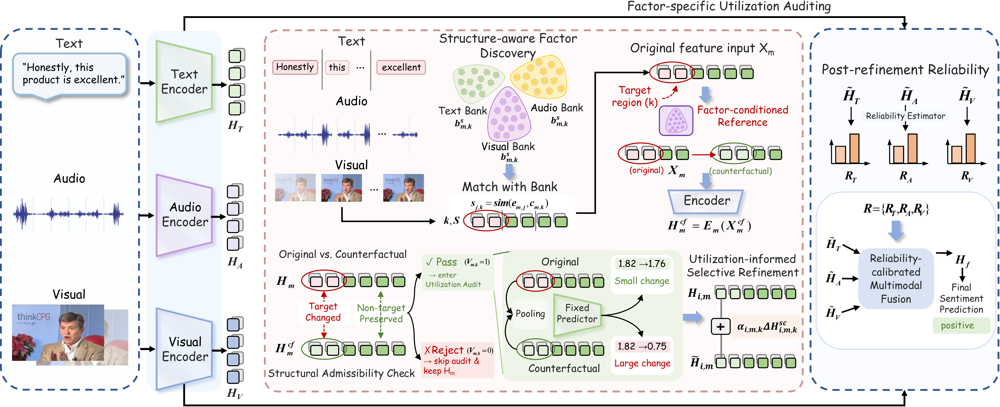
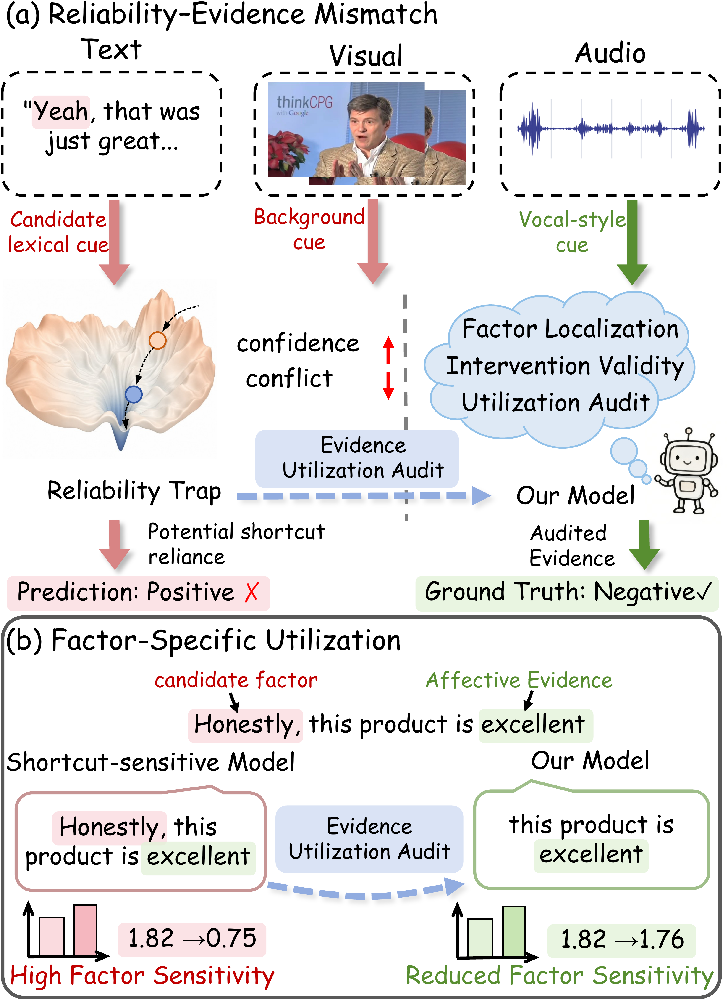
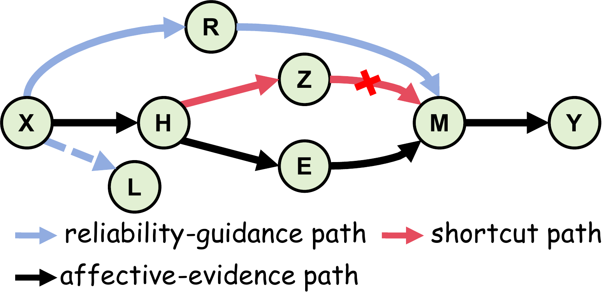
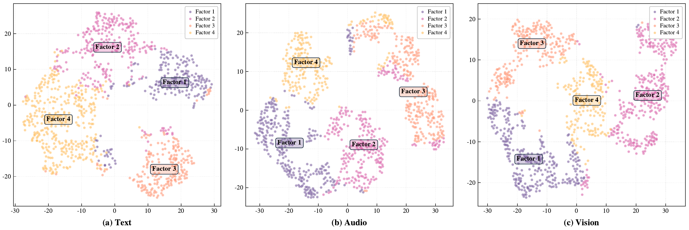

<div align="center">

<h1>FUSER</h1>

<h3>Factor-Utilization-Guided Selective Evidence Refinement<br>for Reliable Multimodal Sentiment Analysis</h3>

<p>Xiaoran Kou · Dingkang Yang · Jingyi Wu · Yang Liu · Jiangchuan Liu · Hong Chen</p>

<p>
  <a href="https://github.com/ma-tubu/FUSER"></a>
  
  
  
</p>

<p>
  <a href="#overview">Overview</a> ·
  <a href="#method">Method</a> ·
  <a href="#visualization">Visualization</a> ·
  <a href="#quick-start">Quick start</a> ·
  <a href="#training">Training</a> ·
  <a href="#project-structure">Project structure</a> ·
  <a href="#citation">Citation</a>
</p>

</div>

<p align="center">
  
  <br>
  <sub>Overview of the FUSER framework.</sub>
</p>

---

## Overview

FUSER models sentiment from text, audio, and visual features. It discovers recurring local
patterns, measures their influence with fixed unimodal predictors, and learns bounded feature
updates. Reliability is recalibrated on the updated features before directed cross-modal fusion.

A high utilization score can reflect an incidental pattern or useful affective evidence.
FUSER learns the refinement strength from the sentiment objective.

<p align="center">
  
  <br>
  <sub>Reliability alone does not reveal which local factors drive a prediction.</sub>
</p>

### Highlights

<table>
  <tr>
    <td width="50%" valign="top">
      <strong>🔎 Structure-aware discovery</strong><br>
      Multiscale local evidence and global summaries retain their input and hidden supports.
      Observed training descriptors form cosine K-medoids factor banks.
    </td>
    <td width="50%" valign="top">
      <strong>🧪 Factor-specific auditing</strong><br>
      Localized, structurally admissible interventions probe a frozen encoder and predictor,
      producing utilization scores without inference-time labels.
    </td>
  </tr>
  <tr>
    <td width="50%" valign="top">
      <strong>🎚️ Selective refinement</strong><br>
      A shared gate combines four audit diagnostics with a modality embedding.
      The downstream sentiment loss learns a bounded adjustment strength.
    </td>
    <td width="50%" valign="top">
      <strong>🔀 Recalibrated fusion</strong><br>
      Error estimators operate on refined representations. Source reliability weights
      six directed interactions between text, audio and vision.
    </td>
  </tr>
</table>

## Method

FUSER consists of four components:

| Step | Component | What it contributes |
|:---:|---|---|
| **01** | **Structure-aware factor discovery** | Extract local spans/windows and global summaries, fit training-only factor banks, and localize matching evidence. |
| **02** | **Factor-specific utilization auditing** | Retrieve a context-compatible training reference, apply a local interpolation, and measure the fixed predictor's response after structural checks. |
| **03** | **Utilization-informed selective refinement** | Form a support-masked counterfactual direction and learn its bounded coefficient from sentiment prediction. |
| **04** | **Reliability-calibrated multimodal fusion** | Re-estimate reliability on refined features, weight six directed attention branches by source reliability, and regress sentiment. |

### Utilization and refinement

The audit measures a factor's predictive influence:

$$
U_m = \tanh\!\left(\frac{|f_m(H_m^{\mathrm{cf}})-f_m(H_m)|}{\tau_u}\right).
$$

The gate uses utilization, matching strength, edit coverage and off-target drift to determine
a bounded coefficient. Only the selected hidden support contributes to the residual update:

$$
\widetilde H_m = H_m + \alpha_m M_m^H \odot (H_m^{\mathrm{cf}}-H_m),
\qquad 0 \leq \alpha_m \leq \alpha_{\max}.
$$

The gate is trained with the sentiment loss and a squared-coefficient penalty.
Inadmissible interventions produce zero refinement.

<details>
<summary><strong>View the reliability and evidence-dependence perspective</strong></summary>

<p align="center">
  
</p>

The diagram separates modality reliability from dependence on local factors.
Audits measure predictor sensitivity to localized feature-space interventions.

</details>

## Visualization

### How factor banks organize evidence

<p align="center">
  
  <br>
  <sub>Local evidence grouped by factor assignment, shown separately for text, audio and vision.</sub>
</p>

## Quick start

### Install

```bash
git clone https://github.com/ma-tubu/FUSER.git
cd FUSER
pip install -e .
```

Python **3.10+** and PyTorch **2.5+** are required. The reference software configuration uses
PyTorch **2.6.0**. Install the PyTorch build appropriate for your hardware before installing
the package if you need CUDA support.

### Configuration guide

| Configuration | Controls |
|---|---|
| [`configs/model.json`](configs/model.json) | Encoders, evidence scales, factor-bank support, reference retrieval, structural checks, refinement and fusion. |
| [`configs/optimization.json`](configs/optimization.json) | Phase-specific learning rates, weight decay, gradient accumulation, gradient clipping and objective parameters. |

The shared architecture uses **128-dimensional representations**, **two** acoustic/visual
Transformer layers, **four** attention heads, and a **16-unit** refinement gate with a
**four-dimensional** modality embedding. Input dimensions, prototype budgets and numerical
settings remain configurable. Each modality preserves its own valid-position mask.

For factor auditing, fit `FactorBank` and `ReferencePool` on training evidence and attach
the resulting `FactorAuditor`. The configuration factory
`build_auditor(training_evidence, config, prototype_budget)` constructs these components
with an explicit prototype budget.

## Training

### Optimization schedule

| Model | Phase | Trainable components | Reliability used by fusion |
|---|---|---|---|
| Unimodal backbone | `base` | Encoders and unimodal sentiment heads | — |
| Unimodal backbone | `error` | Raw error estimators | — |
| FUSER | `initialization` | Fusion; refinement disabled | Raw |
| FUSER | `gate_warmup` | Refinement gate; fusion frozen | Raw |
| FUSER | `refinement` | Refinement gate and fusion | Raw |
| FUSER | `calibration` | Post-refinement error estimators; gate frozen | Error-estimation outputs only |
| FUSER | `fusion` | Fusion; gate and error estimators frozen | Calibrated post-refinement |

Factor-bank construction and discrete auditing take place after unimodal fitting.
After the gate converges, fit the post-refinement error heads on the resulting representations
and call `complete_calibration()`. Final fusion requires fitted post-refinement heads.

## Project structure

```text
FUSER/
├── fuser/
│   ├── models/       # Model components
│   ├── train/        # Losses, optimization and training steps
│   └── utils/        # Configuration and tensor helpers
├── configs/          # Model and optimization settings
├── assets/
│   ├── images/       # README figures
│   └── figures/      # Original vector figures
├── pyproject.toml
└── requirements.txt
```

## Citation

If you use FUSER, please cite:

```bibtex
@misc{kou2026fuser,
  title  = {FUSER: Factor-Utilization-Guided Selective Evidence Refinement
            for Reliable Multimodal Sentiment Analysis},
  author = {Kou, Xiaoran and Yang, Dingkang and Wu, Jingyi and
            Liu, Yang and Liu, Jiangchuan and Chen, Hong},
  year   = {2026},
  url    = {https://github.com/ma-tubu/FUSER}
}
```

## Contact

For questions about the method or implementation:

- **Xiaoran Kou:** [2451806@tongji.edu.cn](mailto:2451806@tongji.edu.cn)
- **Yang Liu:** [yangliu25@tongji.edu.cn](mailto:yangliu25@tongji.edu.cn)
